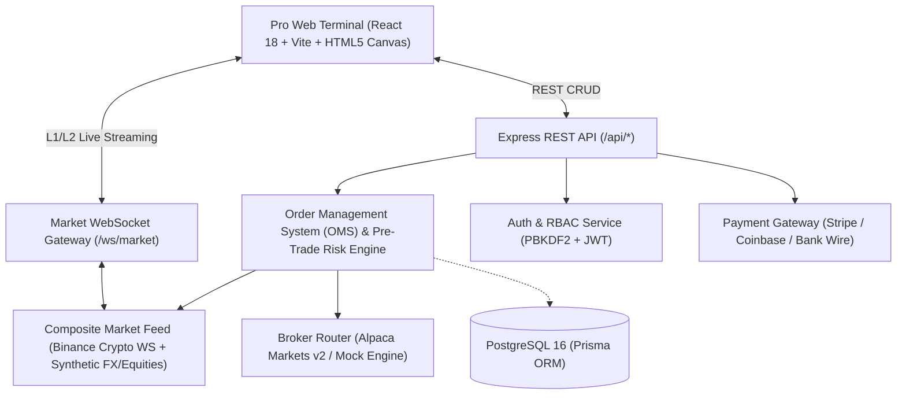

# NEXUS EXCHANGE (XNESS)

> **Production-Grade Original Multi-Asset Trading Terminal & Exchange Platform**

NEXUS EXCHANGE is a clean-slate, institutional-grade multi-asset trading platform designed for modern financial markets (Crypto, FX, Commodities, Equities). Built with uncompromising financial integrity, it provides ultra-low-latency real-time market data feeds, a rigorous pre-trade risk engine, strict margin math, automated stop-out liquidation, and pluggable broker adapters (Alpaca Markets v2 / Local Paper Trading).

---

## 🏛️ System Architecture



---

## 📦 Monorepo Package Layout

```
XNESS/
├── packages/
│   ├── core/                  # Shared domain types, financial math & design tokens
│   │   ├── src/risk/margin.ts # Required margin, liquidation price, P&L, SL/TP validation
│   │   ├── src/types/         # Domain entities (Order, Position, Ticker, Trade, Transaction)
│   │   └── src/design/        # Institutional color tokens & layout constants
│   ├── server/                # Backend API, WebSocket gateway, OMS & provider adapters
│   │   ├── src/engine/        # Pre-trade risk checks, OMS, auto-liquidation & SL/TP monitor
│   │   ├── src/gateway/       # Multiplexed WebSocket streaming gateway
│   │   ├── src/providers/     # Binance WebSocket, Alpaca Markets v2, Stripe & Coinbase
│   │   ├── src/auth/          # PBKDF2 password hashing, secure tokens & RBAC
│   │   └── prisma/            # 16-table relational schema for financial accounting
│   └── client/                # High-density Pro trading terminal (React 18 + Vite)
│       ├── src/components/chart/     # Custom 60fps Canvas charting with draggable SL/TP
│       ├── src/components/order/     # Order entry panel with leverage & risk calculator
│       ├── src/components/watchlist/ # Searchable multi-asset watchlist with live flash ticks
│       ├── src/components/dock/      # Bottom workspace dock (Positions, Orders, Trades, Logs)
│       └── src/components/modals/    # Deposit/Withdrawal, Portfolio Analytics, Admin Console
├── docs/                      # Architectural specifications and wireframes
├── Dockerfile.server          # Multi-stage production container for API server
├── Dockerfile.client          # Multi-stage production container for Nginx client
└── docker-compose.yml         # Full-stack deployment (Postgres + Server + Client)
```

---

## ⚡ Key Highlights & Financial Integrity

1. **Strict Margin & Capital Protection Math**:
   - Fixed-point arithmetic precision to eliminate floating-point rounding errors.
   - Pre-trade validation: checks required margin, commission fees, and free margin before order creation.
   - Institutional Stop-Out rule: when account margin level breaches **50.0%**, the OMS automatically triggers emergency liquidation of positions with the largest unrealized loss to protect remaining equity.
   - Dynamic Liquidation Price line dynamically rendered on the Canvas chart.

2. **Real-Time Market Data Multiplexing**:
   - Zero-auth Binance WebSocket (`wss://stream.binance.com:9443/ws`) for sub-millisecond crypto tickers and depth.
   - Brownian-motion synthetic feeds for Forex, Gold, Oil, and Indices with configurable spreads and tick frequency.
   - Subscriptions multiplexed over a single persistent WebSocket connection (`/ws/market`).

3. **Pluggable Execution Architecture**:
   - Auto-detecting **Broker Router**: seamlessly bridges between Alpaca Markets v2 (Live or Paper sandbox) and local deterministic matching when API credentials are absent.
   - Zero faking: UI strictly displays `PAPER TRADING` unless live broker credentials are explicitly verified.

4. **Interactive HTML5 Canvas Pro Charting**:
   - 60fps candlestick, line, area, volume bars, MA(20), and Bollinger Bands.
   - Interactive draggable Stop Loss and Take Profit tags: drag on canvas to update backend orders via `PATCH /api/positions/:id`.

5. **Multi-Channel Wallet & Custody**:
   - Stripe Checkout and card payment processing with webhook verification.
   - Coinbase Commerce & crypto address generation for BTC, ETH, and USDT.
   - Instant bank wire / SEPA instructions and instant simulated settlement.

---

## 🚀 Quickstart Guide

### 1. Prerequisites
- Node.js 20.x or higher
- npm 10.x or higher

### 2. Installation
```bash
git clone https://github.com/aryanchauhan/XNESS.git
cd XNESS
npm install
```

### 3. Environment Configuration
Copy `.env.example` to `.env`:
```bash
cp .env.example .env
```
*(Optionally fill in `ALPACA_API_KEY`, `ALPACA_API_SECRET`, `STRIPE_SECRET_KEY`, or `COINBASE_COMMERCE_KEY`)*

### 4. Run Development Servers
```bash
# Start both client and server concurrently
npm run dev

# Or start individually:
npm run dev:server   # Starts API & WS gateway on http://localhost:4000
npm run dev:client   # Starts Vite frontend on http://localhost:5173
```

### 5. Run Automated Test Suites
```bash
# Run unit & integration test suites across all packages
npm test
```
*Current test suite: 18/18 passing tests covering financial math, pre-trade risk checks, OMS execution, PBKDF2 authentication, and wallet custody.*

---

## 🐳 Production Deployment with Docker Compose

To launch the entire platform (PostgreSQL database, Node.js server, and Nginx frontend reverse proxy) in production mode:

```bash
docker-compose up --build -d
```

Access points:
- **Terminal UI**: `http://localhost:80`
- **REST API**: `http://localhost:80/api/`
- **WebSocket Gateway**: `ws://localhost:80/ws/market`
- **PostgreSQL**: `localhost:5432`

---

## 🔐 Default Access Accounts

| Role | Email | Password |
|---|---|---|
| **Administrator** | `admin@nexus.exchange` | `NexusAdmin2026!` |
| **Trader** | `trader@nexus.exchange` | `Trader2026!` |

---

## 📜 License
Original proprietary software engineered for the Nexus Exchange project.
All trademarks and brand names referenced in public architecture docs belong to their respective owners.
