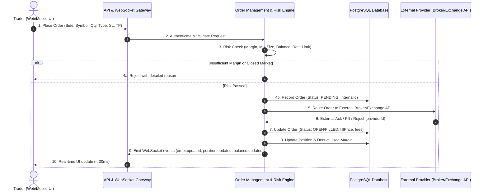

# Phase 1: Reverse-Engineering & Public UX Analysis

## 1. Executive Summary & Regulatory Boundary

This analysis evaluates the publicly observable information architecture, user experience (UX) paradigms, and trading workflows of **Exness** (via public documentation and public marketing/terminal disclosures) to extract architectural patterns for our **original, production-grade trading and exchange platform** (codenamed **"NEXUS EXCHANGE"** / **"XNESS"**).

> **COMPLIANCE & LEGAL NOTICE**:
> - Zero proprietary code, HTML/CSS assets, trademarks, logos, or copyrighted material from Exness was copied or decompiled.
> - All observations are restricted strictly to publicly accessible marketing surfaces, public feature disclosures, and industry-standard financial trading terminal conventions.
> - The software, branding, architecture, database schemas, and frontend/backend implementations developed herein are 100% original.

---

## 2. Public Reference UX & Information Architecture Analysis

### 2.1 The "Exness Terminal" Public Information Architecture

From public product specifications, the standard modern multi-asset web terminal is architected into 4 primary quadrants:

```
┌────────────────────────────────────────────────────────────────────────────────────────┐
│ TOP BAR: Brand | Environment (LIVE / PAPER / DEMO) | Account Switcher | Balance | Deposit│
├─────────────────┬───────────────────────────────────────────────────────┬──────────────┤
│ LEFT PANEL      │ CENTER VIEWPORT                                       │ RIGHT PANEL  │
│ [Watchlist]     │ [Multi-Timeframe Chart / Trading Engine]              │ [Order Entry]│
│ - Market Cats   │ - Top toolbar: Symbol, timeframe, chart type          │ - Buy / Sell │
│   (Forex, Crypto│ - Indicators (100+ standard indicators)               │ - Market/Lmt │
│    Stocks, etc) │ - Drawing tools (trendlines, fibonacci, rectangles)   │ - Quantity   │
│ - Realtime Bid  │ - Overlays: Open position lines, pending order levels │ - Price      │
│ - Realtime Ask  │ - Interactive SL/TP drag handles                      │ - SL / TP    │
│ - Dynamic Spread│ - One-click quick trading pill (Quick Buy/Sell)       │ - Cost/Margin│
│ - 24h % Change  │                                                       │ - Submit CTA │
├─────────────────┴───────────────────────────────────────────────────────┴──────────────┤
│ BOTTOM PANEL (Tabbed Workspace)                                                        │
│ [Positions (Open)] | [Pending Orders] | [Closed Trades] | [Account Activity / Audit]  │
└────────────────────────────────────────────────────────────────────────────────────────┘
```

### 2.2 Key UX Strengths Observed in Leading Multi-Asset Terminals

1. **Contextual Order Execution & Position Markers**:
   - Instead of isolating order entry to a sidebar form, order levels (Pending, Open, SL, TP) are visualized directly on the chart canvas.
   - Users can drag stop-loss or take-profit handles directly up or down the price axis with real-time pip and dollar P&L previews.
2. **Dense, High-Frequency Market Watchlist**:
   - Tight horizontal columns showing Symbol, Bid, Ask, Spread (in points/pips), and Daily % Change.
   - Visual color pulses (green/red background flash) on price tick updates for Bid and Ask.
   - Instant 1-click filtering across asset categories: Forex (Majors, Minors, Exotics), Crypto, Stocks, Indices, Commodities.
3. **Dual Order Confirmation Modality**:
   - **Default Mode**: Two-step submission with a structured confirmation modal detailing:
     - Instrument, Side, Order Type
     - Entry Price / Estimated Slippage
     - Contract Size / Quantity
     - Margin Required & Available Margin
     - Estimated Fees / Commissions
     - Stop Loss / Take Profit target values in Price, Currency, and % Equity
   - **One-Click Mode**: Streamlined high-speed execution for day-traders with configurable preset lot sizes.
4. **Transparent Account State HUD**:
   - Sticky top/bottom status bar presenting:
     - Balance (Deposited equity minus realized losses + realized profits)
     - Equity (Balance + Unrealized P&L)
     - Margin (Collateral locked in open positions)
     - Free Margin (Equity - Margin)
     - Margin Level % ((Equity / Margin) * 100)
     - Dynamic Warning states: Margin Call threshold (< 60%) and Stop Out / Liquidation threshold (< 0% or broker-specified 20%).

### 2.3 UX Anti-Patterns to Overcome in Our Original Architecture

1. **Information Fragmentation**:
   - *Problem*: Traditional platforms separate deposit/withdrawal wallets, verification, and active trading into disparate portals.
   - *Original Solution*: Unified slide-over drawers for Wallet, Deposits, Withdrawals, and Security Settings that never force the trader to lose their chart state or active order position.
2. **Opaque Execution & Hidden Slippage**:
   - *Problem*: Many retail brokers obscure whether an order is routed to an ECN, market maker, or simulated engine.
   - *Original Solution*: Explicit Execution Badges displaying route, execution latency (in ms), fill price vs. requested price, and live connection status (e.g., `WebSocket: 14ms | Provider: Alpaca Live / Binance ECN / Paper Simulator`).
3. **Slow Mobile Transitions**:
   - *Problem*: Desktop-first terminals that simply scale down onto mobile become cluttered and unusable.
   - *Original Solution*: Dedicated mobile layout featuring bottom-sheet order execution, thumb-accessible swipe tabs, and full-screen gestures for charting.

---

## 3. High-Level System Workflow


