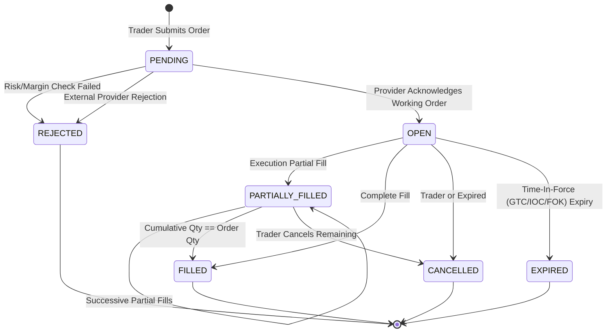

# Technical Architecture Specification

## 1. System Topology Overview

```
                               ┌────────────────────────────────────────┐
                               │           FRONTEND CLIENT              │
                               │   (React, TypeScript, Vanilla CSS)     │
                               │   - Trading Terminal                   │
                               │   - Canvas Charting & Drawing Engine   │
                               │   - Order Entry & Risk Calculator      │
                               │   - Portfolio, Watchlist & Wallet      │
                               └──────────────────┬─────────────────────┘
                                                  │ HTTPS / WSS
                                                  ▼
                               ┌────────────────────────────────────────┐
                               │              API GATEWAY               │
                               │   - TLS Termination, Rate Limiting     │
                               │   - JWT Auth & Session Validation      │
                               │   - Audit Request Logger & Metrics     │
                               │   - WebSocket Protocol Demux           │
                               └──────┬──────────────────────┬──────────┘
                                      │                      │
             ┌────────────────────────┼──────────────────────┼───────────────────────┐
             │ REST (JSON-RPC/REST)   │                      │ Real-Time Streams     │
             ▼                        ▼                      ▼                       ▼
┌────────────────────────┐ ┌──────────────────────┐ ┌──────────────────┐ ┌──────────────────┐
│   Auth & RBAC Service  │ │  Order & Risk Engine │ │ Account & Wallet │ │ Market Data Feed │
│ - Argon2 Hashing       │ │ - Pre-Trade Checks   │ │ - Balance Ledger │ │ - Real-Time Bids │
│ - TOTP 2FA             │ │ - Margin Validation  │ │ - Margin Monitor │ │ - Order Books L2 │
│ - Role Permissions     │ │ - Order State Engine │ │ - Deposits & WD  │ │ - Candlestick Agg│
└────────────┬───────────┘ └──────────┬───────────┘ └────────┬─────────┘ └────────┬─────────┘
             │                        │                      │                    │
             └────────────────────────┴──────────┬───────────┴────────────────────┘
                                                 │
                                                 ▼
                               ┌────────────────────────────────────────┐
                               │          DATABASE PERSISTENCE          │
                               │      (PostgreSQL + Prisma ORM)         │
                               │ - ACID Transactions                   │
                               │ - Strict Numerical Precision (Decimal) │
                               │ - Partitioned Audit Logs & Trades      │
                               └─────────────────┬──────────────────────┘
                                                 │
                                                 ▼
                               ┌────────────────────────────────────────┐
                               │       PROVIDER ABSTRACTION LAYER       │
                               │  - MarketDataProvider                  │
                               │  - BrokerProvider                      │
                               │  - TradingProvider                     │
                               │  - AccountProvider                     │
                               │  - PaymentProvider                     │
                               └───────┬──────────────────────┬─────────┘
                                       │                      │
                 ┌─────────────────────┴──────┐        ┌──────┴────────────────────┐
                 │                            │        │                           │
                 ▼                            ▼        ▼                           ▼
      ┌──────────────────────┐     ┌──────────────────────┐   ┌────────────────────────┐
      │  DEVELOPMENT (Mock)  │     │ PAPER TRADING ENGINE │   │   LIVE BROKER/EXCHANGE │
      │ - Synthetic Orders   │     │ - Live Market Feeds  │   │   (e.g., Binance,      │
      │ - Virtual Balance    │     │ - Simulated Matches  │   │    Alpaca, OANDA API)  │
      └──────────────────────┘     └──────────────────────┘   └────────────────────────┘
```

---

## 2. Environment Modes & Execution Integrity

A core tenet of this platform is that **real trading is NEVER faked**:

| Mode | Market Data Source | Order Execution Route | Financial Settlement | UI Banner Status |
| :--- | :--- | :--- | :--- | :--- |
| **DEVELOPMENT** | Simulated / Local Seed Generator | In-Memory Mock Engine | Mock DB Ledger | `[DEV MODE - ALL MOCKED]` |
| **PAPER_TRADING** | Real-time External WebSocket (Binance / Alpaca) | Local Simulated OMS Matching Engine with Real Slippage Models | Virtual Demo Balance DB | `[PAPER TRADING - SIMULATED EXECUTION]` |
| **LIVE** | Real-time Broker/Exchange WebSocket | Authorized External Broker/Exchange REST/WS API | Real Custodial Broker Account | `[LIVE TRADING - REAL CAPITAL AT RISK]` |

> **CRITICAL RULE**: Live mode is gated behind explicit verified API credentials (e.g. `BROKER_API_KEY`, `BROKER_API_SECRET`). If external connectivity is lost or rejected, the platform explicitly flags the order as `REJECTED` or `DISCONNECTED`—never silently pretending execution occurred.

---

## 3. Order Management System (OMS) & State Machine



### Order Validation & Risk Check Pipeline

Before an order reaches the external provider or matching engine, the server executes an atomic 7-step pre-trade validation:
1. **Instrument Status**: Is trading open for this symbol?
2. **Side & Precision**: Are price and quantity aligned to the symbol's tick size and lot step size?
3. **Notional Value**: Does `Price * Quantity` meet minimum notional limits?
4. **Leverage & Margin Requirement**:
   $$\text{Required Margin} = \frac{\text{Contract Size} \times \text{Quantity} \times \text{Current Price}}{\text{Account Leverage}}$$
5. **Free Margin Verification**: Is $\text{Free Margin} \ge \text{Required Margin} + \text{Estimated Fees}$?
6. **Stop Loss / Take Profit Sanity**:
   - For `BUY`: $SL < \text{Entry Price} < TP$
   - For `SELL`: $SL > \text{Entry Price} > TP$
7. **Rate Limiting & Duplicate Detection**: Idempotency check via client-supplied or generated `clientOrderId`.

---

## 4. Real-Time WebSocket Architecture

### Gateway Channel Subscription Multiplexing

A single bidirectional WebSocket connection handles both public market feeds and private authenticated trading events:

```json
// Client Subscription Message
{
  "action": "subscribe",
  "channels": [
    "ticker:EURUSD",
    "orderbook:BTCUSDT",
    "candles:AAPL:1m",
    "account:orders",
    "account:positions"
  ],
  "token": "bearer-jwt-token-if-authenticated"
}
```

### Standardized Event Payloads

#### 1. `ticker.update`
```json
{
  "event": "ticker.update",
  "data": {
    "symbol": "BTCUSD",
    "bid": 94820.50,
    "ask": 94821.10,
    "lastPrice": 94820.80,
    "spread": 0.60,
    "volume24h": 18452.32,
    "high24h": 95600.00,
    "low24h": 93100.20,
    "change24h": 1.45,
    "timestamp": 1774028400000
  }
}
```

#### 2. `order.updated`
```json
{
  "event": "order.updated",
  "data": {
    "internalId": "ord_9182391283",
    "providerId": "ext_binance_991823",
    "symbol": "BTCUSD",
    "side": "BUY",
    "type": "LIMIT",
    "quantity": 0.50,
    "price": 94500.00,
    "status": "PARTIALLY_FILLED",
    "filledQuantity": 0.25,
    "averageFillPrice": 94500.00,
    "fee": 11.81,
    "feeCurrency": "USD",
    "updatedAt": 1774028402100
  }
}
```

#### 3. `position.updated`
```json
{
  "event": "position.updated",
  "data": {
    "symbol": "BTCUSD",
    "side": "LONG",
    "quantity": 0.50,
    "entryPrice": 94500.00,
    "currentPrice": 94820.50,
    "unrealizedPnl": 160.25,
    "realizedPnl": 0.00,
    "margin": 948.20,
    "leverage": 50,
    "liquidationPrice": 75600.00,
    "stopLoss": 93000.00,
    "takeProfit": 98000.00,
    "updatedAt": 1774028402150
  }
}
```

---

## 5. Security & Threat Model

1. **Broker Credentials Shielding**:
   - External broker/exchange API keys are encrypted at rest using AES-256-GCM with environment-managed master keys.
   - Credentials NEVER touch browser JavaScript or client storage.
2. **Financial Precision**:
   - All balances, quantities, prices, fees, and margins use fixed-point `Prisma.Decimal` (PostgreSQL `NUMERIC(28, 8)`), preventing IEEE-754 floating-point inaccuracies.
3. **Session & Cookie Security**:
   - `HttpOnly`, `SameSite=Strict`, `Secure` cookies for session tokens.
   - In-memory CSRF double-submit protection.
4. **Role-Based Access Control (RBAC)**:
   - `USER`: Read-only public market data & watchlists.
   - `TRADER`: Active order creation, position management, wallet operations on own account.
   - `SUPPORT`: Read-only customer assistance (no ability to place orders or withdraw funds).
   - `ADMIN`: Platform configuration, instrument management, provider monitoring, audit logs.
